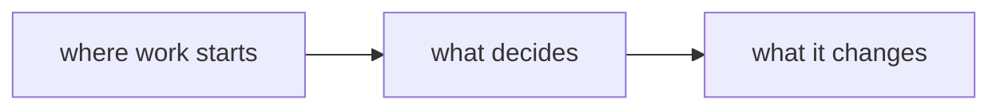

# <Project> — design

**Status:** design · **Depth:** prompt · **Updated:** <YYYY-MM-DD> · **Task:** <native:… or #slug>
**Slug:** <this-doc-slug> · **Parent:** <parent-slug#row-id, or `none`> · **Forked from:** <slug, if any>

> One sentence: what changes, and for whom.

## How it works



## Breakdown

### <First group — delete the `###` headings while the list is short>

- [ ] <a1> First slice — `path/to/file.ts#theFunctionItChanges` — acceptance: <what proves it, observably>
  - [ ] <a2> A sub-task, if the slice has parts
- [ ] <b1> Second slice — after: #a1 — `path/to/other.ts#TheTypeItAdds` — acceptance: <…>
- [ ] <c1> Open the PR and merge it — gate:human — after: #b1 — acceptance: the ref in the table
      below resolves to a merged PR
- [ ] <d1> Too big for one PR — gate:design — → `docs/<child-slug>/index.md`

## Pull requests

| PR | Change | Status |
|---|---|---|
| | | |

| Commit | Change |
|---|---|
| | |

---

## Research notes

### Decisions, and what was rejected

| Decision | Why | Rejected, and why |
|---|---|---|
| | | |

### Verified claims

| Claim | Evidence | Status |
|---|---|---|
| | | |

### Could not verify

### Commands that produced the evidence

```bash
grep -rn "<the thing>" --include='*.ts' server scripts src
```
